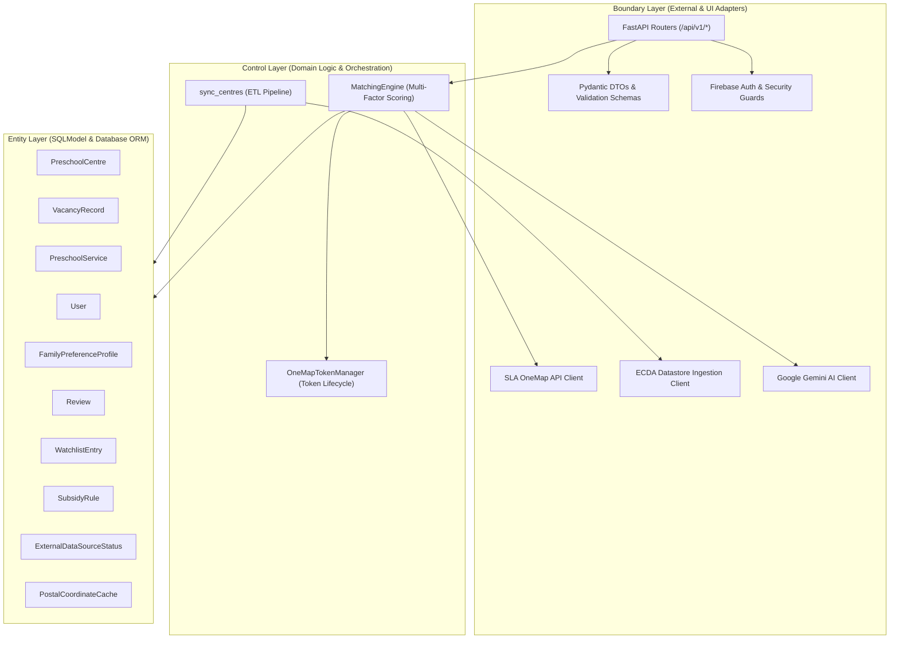
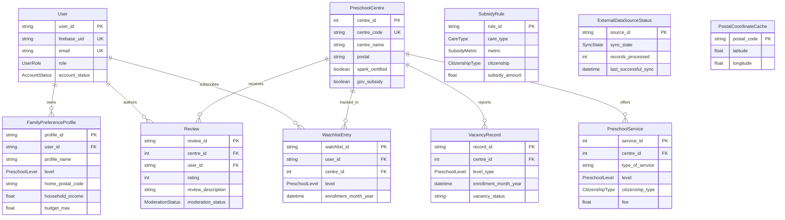
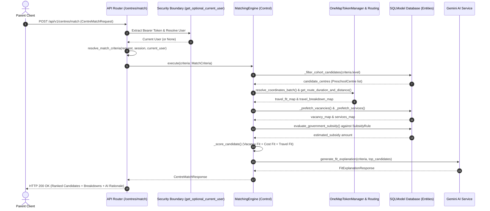

# KidCare Match SG — Backend Architecture & Class Documentation

KidCare Match SG is an intelligent childcare centre discovery, subsidy calculation, and vacancy matching backend tailored for parents and administrators in Singapore. The platform integrates official government preschool datasets (ECDA via data.gov.sg), Singapore Land Authority (SLA) OneMap geospatial transit APIs, and Google Gemini Generative AI into a unified multi-criteria recommendation engine.

---

## 1. Architectural Architecture & BCE Pattern

The backend follows the **Boundary-Control-Entity (BCE)** pattern combined with Layered Clean Architecture to isolate domain logic from external transport layers and infrastructure dependencies:



### Architectural Mapping

| BCE Component | System Role | Codebase Location |
| :--- | :--- | :--- |
| **Entities** | Persistent domain models and relational database schemas | `src/kidcarematch_backend/db/db.py` |
| **Controls** | Business logic, scoring algorithms, and token lifecycle managers | `src/kidcarematch_backend/core/matching.py`, `src/kidcarematch_backend/core/onemap.py` |
| **Boundaries (Adapters)** | External integration interfaces (ECDA, OneMap, Gemini AI, Firebase) | `src/kidcarematch_backend/auth/security.py`, `src/kidcarematch_backend/core/explanation.py`, `src/kidcarematch_backend/cron/` |
| **Boundaries (Schemas)** | Inbound request validation and outbound response serialization | `src/kidcarematch_backend/schemas/` |
| **Boundaries (Routers)** | HTTP REST endpoints translating network requests into control invocations | `src/kidcarematch_backend/api/v1/` |

---

## 2. Control Classes

Control classes encapsulate domain-specific business rules, coordination between external boundaries, and algorithmic decision-making.

### `MatchingEngine`

- **Module**: `kidcarematch_backend.core.matching`
- **Design Intent**: Encapsulates the complete multi-criteria preschool matching algorithm (ADR-0007, Spec #66). Rather than scattering calculation logic across route handlers, `MatchingEngine` serves as a deep control class that orchestrates:
  1. **Strict Cohort Filtering**: Excludes candidate centres not offering the child's requested `PreschoolLevel`.
  2. **Two-Stage Spatial Detour Routing**: Pre-filters candidates via straight-line corridor deviations (Stage 1) and evaluates top candidates via public transit routing (Stage 2) using OneMap.
  3. **Government Subsidy Evaluation**: Computes means-tested Singapore ECDA subsidies (Basic and Additional) across Gross Household Income (HHI) and Per-Capita Income (PCI).
  4. **Multi-Factor Scoring**: Calculates Vacancy Fit ($0\%-100\%$), Cost Fit ($0\%-100\%$), and Travel Fit ($0\%-100\%$), combined into a weighted Overall Fit.
  5. **AI Explanation Orchestration**: Sorts candidates globally, extracts top results, and invokes Gemini AI for comparative natural-language narratives.

#### Key Public Methods

##### `__init__(session, *, geocoding_adapter=..., routing_adapter=..., explanation_generator=...)`
Initializes the engine with an active database session and optional pluggable collaborators for geocoding, transit routing, and AI explanation generation (enabling isolated testing and dependency injection).

##### `execute(criteria: MatchCriteria) -> CentreMatchResponse`
Executes the end-to-end matching workflow against the provided domain criteria and returns a structured response containing ranked candidates, breakdowns, and AI narratives.

- **Parameters**: `criteria` (`MatchCriteria`): Encapsulated, pre-validated matching parameters.
- **Returns**: `CentreMatchResponse`: Contains candidate rankings, fit scores, financial breakdowns, transit detour metrics, and AI explanation.
- **Invariants**:
  - If no candidate centres offer the requested cohort level, returns 0 candidates with a descriptive fallback explanation without executing expensive routing or subsidy queries.
  - Normalizes travel fit scores pool-relatively ($100\%$ for lowest commute deviation, $0\%$ for largest).

#### Usage Example

```python
from sqlmodel import Session
from kidcarematch_backend.db.db import engine, PreschoolLevel, LocationPreference
from kidcarematch_backend.schemas.match import MatchCriteria
from kidcarematch_backend.core.matching import MatchingEngine

criteria = MatchCriteria(
    level=PreschoolLevel.INFANT,
    enrollment_month_year="2026-07",
    home_postal_code="560123",
    workplace_postal_code="048624",
    location_preference=LocationPreference.EITHER,
    budget_max=900.0,
    household_income=6500.0,
    household_member_count=3,
    vacancy_weight=0.40,
    cost_weight=0.30,
    travel_weight=0.30,
    top_n=5,
)

with Session(engine) as session:
    engine = MatchingEngine(session)
    response = engine.execute(criteria)
    print(f"Evaluated {response.total_candidates} centres. Top recommendation:")
    if response.results:
        top = response.results[0]
        print(f"1. {top.centre_name} - Overall Fit: {top.overall_fit_score}%")
        print(f"   Rationale: {response.explanation.top_centre_rationale}")
```

---

### `OneMapTokenManager`

- **Module**: `kidcarematch_backend.core.onemap`
- **Design Intent**: Provides thread-safe, self-healing, in-memory lifecycle management for SLA OneMap Service Account access tokens (ADR-0008). Avoids static token expiration outages (OneMap tokens expire every 72 hours) and database write contention.
- **Key Capabilities**:
  - **Double-Checked Locking**: Uses `threading.RLock` to guard token acquisition without blocking fast-path token reads.
  - **Proactive Renewal**: Re-authenticates within 300 seconds of token expiration (`REFRESH_BUFFER_SECS = 300.0`).
  - **Reactive 401 Eviction**: Evicts cached tokens on upstream HTTP 401 Unauthorized responses to force a clean refresh on the next request.
  - **Resilient Fallback**: Falls back to static `ONEMAP_API_TOKEN` if service account credentials are unconfigured.

#### Key Public Methods & Properties

##### `token -> str | None`
Property returning the currently cached access token string or `None`.

##### `expiry_timestamp -> float | None`
Property returning the Unix epoch expiration timestamp float or `None`.

##### `get_valid_token(client: httpx.Client | None = None) -> str | None`
Returns an active, valid OneMap access token, executing dynamic token retrieval or proactive refresh under lock if expired.

##### `get_auth_headers(client: httpx.Client | None = None) -> dict[str, str]`
Returns standard HTTP Bearer headers `{"Authorization": f"Bearer {token}"}` or an empty dictionary if unauthenticated.

##### `invalidate_token() -> None`
Thread-safely clears the cached token and expiration timestamp, used during reactive 401 handling.

##### `probe_token_health(client: httpx.Client | None = None) -> tuple[bool, str | None]`
Performs a diagnostic probe against the OneMap authentication endpoint, returning `(True, None)` on success or `(False, error_message)` on failure for administrative monitoring.

#### Usage Example

```python
import httpx
from kidcarematch_backend.core.onemap import onemap_token_manager

# Acquire authorization headers
headers = onemap_token_manager.get_auth_headers()

# Execute request with reactive 401 eviction
with httpx.Client() as client:
    resp = client.get("https://www.onemap.gov.sg/api/common/elastic/search", params={"searchVal": "560123"}, headers=headers)
    if resp.status_code == 401:
        onemap_token_manager.invalidate_token()
        retry_headers = onemap_token_manager.get_auth_headers(client=client)
        resp = client.get("https://www.onemap.gov.sg/api/common/elastic/search", params={"searchVal": "560123"}, headers=retry_headers)
```

---

### `Settings`

- **Module**: `kidcarematch_backend.core.config`
- **Design Intent**: Encapsulates runtime environment configuration using Pydantic's `BaseSettings`. Loads variables from `.env` with type casting and defaults for database connections, external endpoints, and CORS origins.

#### Key Configuration Fields

- `DATABASE_URL`: Connection string (defaults to SQLite in-memory or PostgreSQL).
- `DATA_GOV_SG_API_URL`, `DATA_GOV_SG_CENTRES_RESOURCE_ID`, `DATA_GOV_SG_SERVICES_RESOURCE_ID`: Datastore endpoints for ECDA centres and services.
- `ONEMAP_AUTH_URL`, `ONEMAP_API_URL`, `ONEMAP_ROUTING_API_URL`, `ONEMAP_EMAIL`, `ONEMAP_PASSWORD`, `ONEMAP_API_TOKEN`: OneMap service account credentials and endpoints.
- `GEMINI_API_KEY`, `GEMINI_MODEL`: Google Gemini generative AI credentials and model selection (`gemini-2.5-flash`).
- `FIREBASE_PROJECT_ID`, `FIREBASE_CREDENTIALS_PATH`: Firebase Admin SDK configuration.
- `CORS_ALLOWED_ORIGINS`: Approved client origins for browser cross-origin requests.

---

## 3. Entity Classes (Domain & Database Models)

All database entities are defined using SQLModel in `src/kidcarematch_backend/db/db.py`. They enforce domain invariants, foreign key constraints, and cascade delete semantics.

### Entity Relationship Model



---

### `PreschoolCentre`

- **Design Intent**: Represents an ECDA-licensed preschool centre or kindergarten in Singapore (identified primarily by `centre_code`).
- **Key Fields**:
  - `centre_id: int | None` (Surrogate Primary Key).
  - `centre_code: str` (Unique natural business key).
  - `centre_name: str`, `postal: str | None`, `address: str | None`.
  - `spark_certified: bool`, `transport_provided: bool`, `gov_subsidy: bool`.
  - `weekday_full_day_hours: str | None`, `saturday_hours: str | None`, `extended_operating_hours: bool`.
- **Relationships**:
  - `vacancies: list[VacancyRecord]`: Cascade delete-orphan relationship.
  - `services: list[PreschoolService]`: Cascade delete-orphan relationship.
  - `reviews: list[Review]`: Cascade delete-orphan relationship.
  - `watchlist_entries: list[WatchlistEntry]`: Cascade delete-orphan relationship.

---

### `VacancyRecord`

- **Design Intent**: Captures reported admission vacancy availability for a specific age level and enrollment month over ECDA's 7-month forward-looking horizon (ADR-0001).
- **Key Fields**:
  - `record_id: str | None` (Primary Key; deterministic composite key: `{centre_code}_{level}_{YYYYMM}`).
  - `centre_id: int` (Foreign Key referencing `preschoolcentre.centre_id` with `ondelete="CASCADE"`).
  - `level_type: PreschoolLevel` (`infant`, `pg`, `n1`, `n2`, `k1`, `k2`, `student_care`).
  - `enrollment_month_year: datetime` (Normalized to day 1, 00:00:00 UTC).
  - `vacancy_status: str` (`Available`, `Immediate`, `Limited`, `Full`, `Not Applicable`).

---

### `PreschoolService`

- **Design Intent**: Represents a specific program offering at a centre, defining developmental level, citizenship tier, service type, and monthly fee (ADR-0001).
- **Key Invariants**:
  - Unique constraint `uq_preschool_service_offering` on `(centre_id, type_of_service, level, citizenship_type)`.
- **Key Fields**:
  - `service_id: int | None` (Primary Key).
  - `centre_id: int` (Foreign Key referencing `preschoolcentre.centre_id` with `ondelete="CASCADE"`).
  - `type_of_service: str` (e.g. `Full Day`, `Half Day`).
  - `level: PreschoolLevel`.
  - `fee: float` (Published monthly programme fee in SGD).
  - `citizenship_type: CitizenshipType` (`SC`, `SPR`, `OTHERS`).

---

### `User`

- **Design Intent**: Unified user identity entity representing parents and administrators (ADR-0002). Decouples internal surrogate UUIDs from Firebase Authentication UIDs (ADR-0003).
- **Key Fields**:
  - `user_id: str` (UUID Primary Key).
  - `firebase_uid: str` (Unique indexed external subject identifier).
  - `email: str` (Unique indexed email address).
  - `full_name: str`.
  - `role: UserRole` (`PARENT`, `ADMIN`).
  - `account_status: AccountStatus` (`ACTIVE`, `SUSPENDED`).
  - `admin_level: int | None` (Administrative tier).
- **Relationships**:
  - `preference_profiles: list[FamilyPreferenceProfile]`: Cascade delete-orphan.
  - `reviews: list[Review]`: Cascade delete-orphan.
  - `watchlist_entries: list[WatchlistEntry]`: Cascade delete-orphan.

---

### `FamilyPreferenceProfile`

- **Design Intent**: Encapsulates a parent-configured matching criteria profile representing a child or commute scenario (ADR-0006). Enables a multi-profile portfolio per parent.
- **Key Invariants**:
  - Unique constraint `uq_family_profile_user_profile_name` on `(user_id, profile_name)`.
- **Key Fields**:
  - `profile_id: str` (UUID Primary Key).
  - `user_id: str` (Foreign Key referencing `user.user_id` with `ondelete="CASCADE"`).
  - `profile_name: str`.
  - `level: PreschoolLevel`, `citizenship_status: CitizenshipType`, `service_required: str`.
  - `home_postal_code: str`, `workplace_postal_code: str | None`, `location_preference: LocationPreference`.
  - `household_income: float`, `household_member_count: int`, `budget_max: float`.
  - `vacancy_weight: float`, `cost_weight: float`, `travel_weight: float`.
  - `applicant_status: ApplicantStatus`.

---

### `Review`

- **Design Intent**: Parent-submitted evaluation of a preschool centre featuring star ratings and qualitative commentary under a reactive moderation model (ADR-0004).
- **Key Invariants**:
  - Unique constraint `uq_review_centre_user` on `(centre_id, user_id)` (one review per parent per centre).
  - Check constraint `ck_review_rating_1_to_5` bounding ratings between 1 and 5.
- **Key Public Methods**:
  - `validate_rating(cls, v: int) -> int`: Pydantic validator ensuring $1 \le \text{rating} \le 5$.
  - `_validate_rating_sa(self, key: str, value: int) -> int`: SQLAlchemy `@validates` hook enforcing rating validation during ORM mutations.

---

### `WatchlistEntry`

- **Design Intent**: Cohort-specific vacancy notification subscription for a specific level and enrollment month (ADR-0002).
- **Key Invariants**:
  - Unique constraint `uq_watchlist_entry` on `(user_id, centre_id, level, enrollment_month_year)`.

---

### `SubsidyRule`

- **Design Intent**: Encapsulates Singapore government early childhood subsidy policy structures (Basic & Additional Subsidies) (ADR-0002, ADR-0007).
- **Key Fields**:
  - `rule_id: str` (Primary Key).
  - `subsidy_name: str`, `tier_name: str | None`.
  - `care_type: CareType` (`INFANT_CARE`, `CHILD_CARE`).
  - `metric: SubsidyMetric` (`FIXED`, `HOUSEHOLD_INCOME`, `PER_CAPITA_INCOME`).
  - `applicant_status: ApplicantStatus | None`.
  - `citizenship: CitizenshipType`.
  - `income_min: float | None`, `income_max: float | None`.
  - `subsidy_amount: float`.

---

### `ExternalDataSourceStatus`

- **Design Intent**: Persistent operational heartbeat tracking synchronizations with external data providers (`ECDA_DATASTORE`, `ONEMAP_API`) (ADR-0002, ADR-0005).
- **Key Fields**:
  - `source_id: str` (Primary Key).
  - `sync_state: SyncState` (`IDLE`, `RUNNING`, `SUCCESS`, `FAILED`).
  - `records_processed: int`, `error_message: str | None`.
  - `last_successful_sync: datetime | None`, `last_attempted_sync: datetime | None`.

---

### `PostalCoordinateCache`

- **Design Intent**: Persistent spatial cache mapping 6-digit Singapore postal codes to latitude, longitude, and SVY21 coordinates resolved from OneMap (ADR-0007, ADR-0008). Avoids repeated geocoding HTTP round-trips.

---

## 4. Boundary & Adapter Classes

Boundary classes manage integration across system perimeters, including security token verification, external API adapters, and scheduled ingestion jobs.

### `FirebaseTokenClaims`

- **Module**: `kidcarematch_backend.auth.security`
- **Design Intent**: Pydantic DTO representing authenticated identity claims (`uid`, `email`) decoded from a cryptographically verified Firebase ID token.
- **Key Public Functions (FastAPI Dependencies)**:
  - `get_token_claims(auth_credentials)`: Verifies Bearer ID token via Firebase Admin SDK.
  - `get_current_user(claims, session)`: Maps verified Firebase UID to a local database `User` record; verifies `AccountStatus != SUSPENDED`.
  - `get_current_parent(current_user)`: Validates that the active user possesses `UserRole.PARENT`.
  - `get_current_admin(current_user)`: Validates that the active user possesses `UserRole.ADMIN`.

---

### Ingestion Pipeline (`sync_centres.py`)

- **Module**: `kidcarematch_backend.cron.sync_centres`
- **Design Intent**: Operational background script synchronizing preschool centres, 7-month vacancy records, and program service tiers from data.gov.sg datastore APIs into PostgreSQL.
- **Key Public Functions**:
  - `sync_centres(max_records=None, dry_run=False, db_engine=None, sync_date=None) -> dict[str, int]`: Executes full upsert ETL pipeline, updating `ExternalDataSourceStatus` heartbeat records.
  - `fetch_all_centres(resource_id, batch_size=1000)`: Paginated datastore ingestion for centres.
  - `fetch_all_services(resource_id, batch_size=5000)`: Paginated datastore ingestion for services.

---

### AI Explanation Service (`explanation.py`)

- **Module**: `kidcarematch_backend.core.explanation`
- **Design Intent**: Interfaces with Google Gemini Generative AI (`gemini-2.5-flash`) to generate human-readable matching narratives explaining top recommendations and trade-offs.
- **Key Public Functions**:
  - `generate_fit_explanation(...) -> FitExplanationResponse`: Calls Gemini with JSON schema enforcement; automatically falls back to deterministic template generation if the API key is absent or an error occurs.
  - `build_explanation_prompt(...) -> str`: Formats structured scoring inputs and candidate attributes into an AI prompt.
  - `generate_deterministic_fallback(...) -> FitExplanationResponse`: Synthesizes a deterministic explanation guarantee zero API failures.

---

## 5. Domain Transfer & Criteria Classes

### `MatchCriteria`

- **Module**: `kidcarematch_backend.schemas.match`
- **Design Intent**: Pure domain dataclass decoupling matching algorithm parameters from HTTP request payloads and database models (ADR-0007).
- **Key Attributes**:
  - `level: PreschoolLevel`
  - `enrollment_month_year: str`
  - `citizenship_status: CitizenshipType = CitizenshipType.SC`
  - `service_required: str = "Full Day"`
  - `household_income: float = 0.0`
  - `household_member_count: int = 1`
  - `budget_max: float | None = None`
  - `home_postal_code: str | None = None`
  - `workplace_postal_code: str | None = None`
  - `location_preference: LocationPreference = LocationPreference.HOME`
  - `vacancy_weight: float = 0.40`
  - `cost_weight: float = 0.30`
  - `travel_weight: float = 0.30`
  - `applicant_status: ApplicantStatus = ApplicantStatus.WORKING_APPLICANT`
  - `top_n: int = 5`
  - `profile_id: str | None = None`

---

## 6. Request & Response Schemas (Pydantic DTOs)

Pydantic schemas enforce type validation, domain formatting rules, and API input/output serialization.

### Matching Schemas (`schemas/match.py`)

- `CentreMatchRequest`: Request payload for matching. Supports either saved `profile_id` or inline parameters.
  - **Key Method**: `validate_request_invariants()`: Ensures required fields are present when `profile_id` is omitted, verifies workplace postal code if required by location preference, and validates that `vacancy_weight + cost_weight + travel_weight == 1.0`.
- `CentreMatchResponse`: Top-level response returning ranked candidates, total counts, and AI explanation narrative.
- `MatchCandidateItem`: Extends `PreschoolCentreItem` with `vacancy_fit_score`, `cost_fit_score`, `travel_fit_score`, `overall_fit_score`, `fee_breakdown`, `travel_breakdown`, and AI `highlight`.
- `FeeBreakdownItem`: Itemized fee calculation (`published_fee`, `estimated_subsidy`, `estimated_monthly_payable_fee`, `cost_fit`, `remarks`).
  - **Key Method**: `_sync_remarks(data)`: Synchronizes legacy and incidental remarks fields.
- `TravelBreakdownItem`: Transit calculation breakdown (`commute_duration_mins`, `commute_deviation_mins`, `commute_distance_km`, `baseline_duration_mins`, `baseline_distance_km`).
- `FitExplanationResponse`: AI response schema (`summary_narrative`, `top_centre_rationale`, `candidate_highlights`).

---

### Family Preference Profile Schemas (`schemas/profile.py`)

- `ProfileCreateRequest`: Request payload for creating a profile.
  - **Key Methods**:
    - `validate_home_postal(v)`: Enforces 6-digit Singapore postal code format.
    - `validate_workplace_postal(v)`: Validates workplace postal if provided.
    - `validate_enrollment_month(v)`: Enforces `YYYY-MM` format.
    - `validate_cross_field_rules()`: Ensures workplace postal is present when preference is `WORKPLACE` or `EITHER`, and weights sum to 1.0.
    - `get_enrollment_datetime() -> datetime`: Converts `YYYY-MM` into the 1st of the month at 00:00:00 UTC.
- `ProfileResponse`: Serialized representation of a preference profile.
  - **Key Method**: `format_enrollment_month_year(v)`: Formats datetime to `YYYY-MM`.
- `ProfileUpdateRequest`: Full replacement model inheriting validation rules from `ProfileCreateRequest`.
- `ProfilePatchRequest`: Partial update schema with selective validation for non-nullable fields.

---

### Centre & Review Schemas (`schemas/centre.py`, `schemas/review.py`)

- `PreschoolCentreItem`: Centre summary for listings.
  - **Key Method**: `populate_district() -> Self`: Automatically resolves Singapore postal district number and name from the postal code.
- `PreschoolCentreDetailResponse`: Comprehensive centre profile extending `PreschoolCentreItem` with vacancies, services, and review summary.
- `ReviewCreateRequest` / `ReviewUpdateRequest`: Enforce rating bounds ($1 \le \text{rating} \le 5$).
- `ReviewResponse` / `UserReviewItem`: Serialized reviews enriched with author and centre details.
- `CentreSummaryResponse`: High-level dashboard aggregate counts.

---

### User & Administration Schemas (`schemas/user.py`, `schemas/admin.py`)

- `UserSignupRequest`: Validates full name and provisions user profile.
- `AdminUserCreateRequest` / `AdminUserUpdateRequest`: Administrative account management and RBAC level assignment.
- `AdminReviewItem` / `AdminReviewStatusUpdateRequest`: Review moderation workflow schemas.
- `SubsidyRuleCreate` / `SubsidyRuleUpdate`: Subsidy matrix configuration.
  - **Key Method**: `validate_income_range()`: Asserts `income_min <= income_max`.
- `DataSourceStatusResponse`: Operational heartbeat response schema.

---

### Watchlist Schemas (`schemas/watchlist.py`)

- `WatchlistCreateRequest`: Validates cohort alert subscription parameters.
  - **Key Method**: `normalize_enrollment_month_year(v) -> datetime`: Normalizes target month to day 1 at 00:00:00 UTC.
- `UserWatchlistItem`: Enriched watchlist entry with centre details and current vacancy status.
- `CentreWatchlistStatusResponse`: Introspection endpoint checking if a centre is watched by the current parent.

---

## 7. End-to-End Matching Workflow

The following sequence illustrates how the classes collaborate during a matching request:



---

## 8. Development & Toolchain Commands

All operations use `uv` package manager:

```powershell
# Run entire test suite (580+ tests)
uv run pytest

# Static type checking
uv run mypy src tests

# Code formatting and linting
uv run ruff check .

# Run external dataset sync job manually
uv run python -m kidcarematch_backend.cron.sync_centres
```
