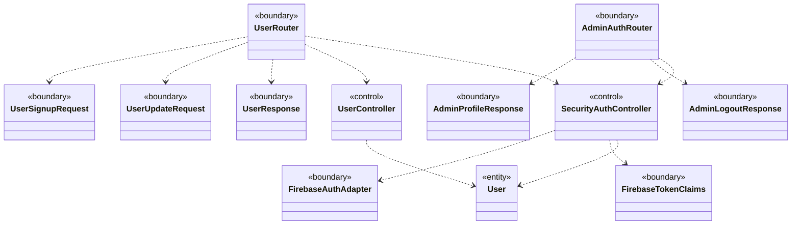
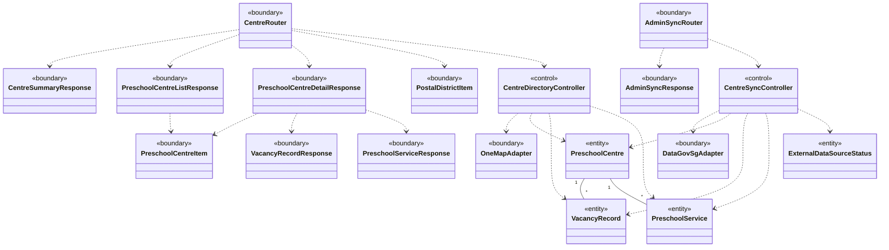
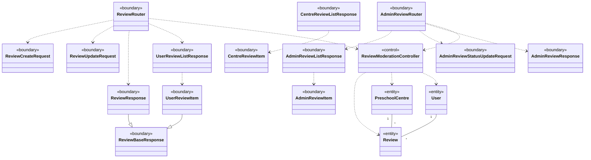
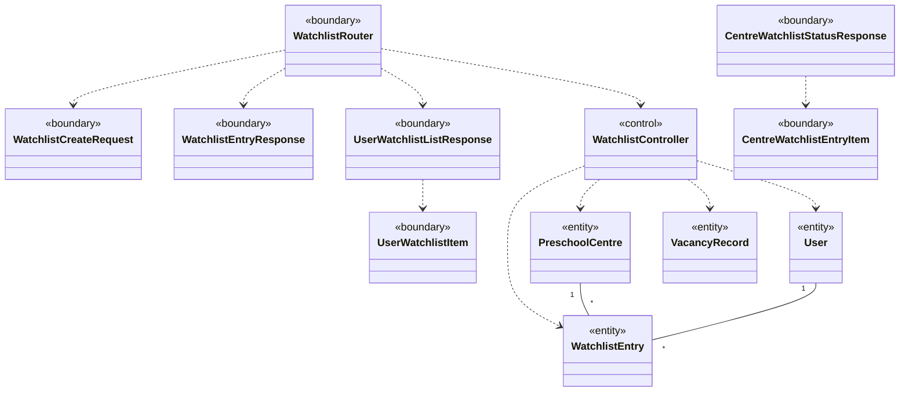
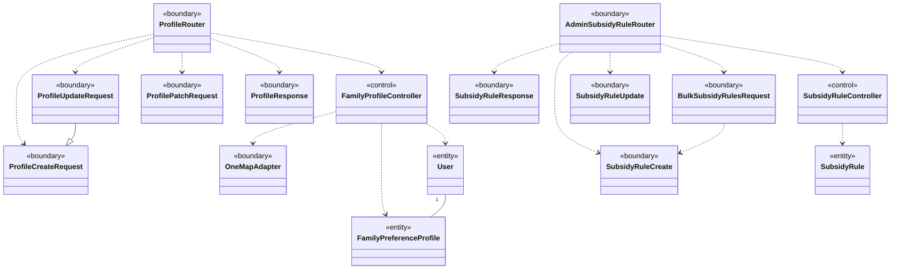
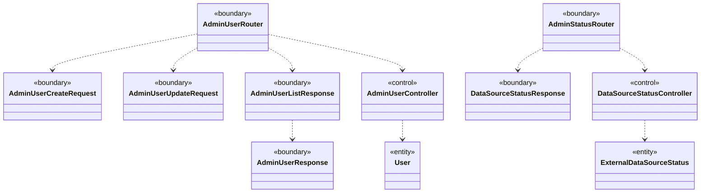

# Boundary-Entity-Control (BCE) Architectural Design

This document details the software architecture of the KidCareMatch backend using the **Boundary-Entity-Control (BCE / ECB)** architectural pattern (also known as Robustness Analysis).

In alignment with the repository design:
- **Entity classes**: Represent persistent domain models and state stored in the database.
- **Control classes**: Encapsulate business logic, workflow rules, transaction boundaries, and orchestration between boundaries and entities.
- **Boundary classes**: Represent API endpoints, external service adapters, and request/response data transfer objects (DTOs) that mediate interactions with actors and external systems.

> [!NOTE]
> Per specification, all diagrams display **class names only** without attributes or methods.

---

## 1. High-Level BCE Architecture Diagram

The high-level BCE class diagram illustrates the primary boundaries, business controllers, and domain entities across the backend system.

```mermaid
classDiagram
    direction TB

    %% Boundary Classes
    class UserRouter {
        <<boundary>>
    }
    class CentreRouter {
        <<boundary>>
    }
    class ReviewRouter {
        <<boundary>>
    }
    class WatchlistRouter {
        <<boundary>>
    }
    class ProfileRouter {
        <<boundary>>
    }
    class AdminAuthRouter {
        <<boundary>>
    }
    class AdminUserRouter {
        <<boundary>>
    }
    class AdminReviewRouter {
        <<boundary>>
    }
    class AdminSubsidyRuleRouter {
        <<boundary>>
    }
    class AdminSyncRouter {
        <<boundary>>
    }
    class AdminStatusRouter {
        <<boundary>>
    }
    class FirebaseAuthAdapter {
        <<boundary>>
    }
    class DataGovSgAdapter {
        <<boundary>>
    }
    class OneMapAdapter {
        <<boundary>>
    }

    %% Control Classes
    class SecurityAuthController {
        <<control>>
    }
    class UserController {
        <<control>>
    }
    class CentreDirectoryController {
        <<control>>
    }
    class ReviewModerationController {
        <<control>>
    }
    class WatchlistController {
        <<control>>
    }
    class FamilyProfileController {
        <<control>>
    }
    class AdminUserController {
        <<control>>
    }
    class SubsidyRuleController {
        <<control>>
    }
    class CentreSyncController {
        <<control>>
    }
    class DataSourceStatusController {
        <<control>>
    }

    %% Entity Classes
    class User {
        <<entity>>
    }
    class PreschoolCentre {
        <<entity>>
    }
    class VacancyRecord {
        <<entity>>
    }
    class PreschoolService {
        <<entity>>
    }
    class FamilyPreferenceProfile {
        <<entity>>
    }
    class Review {
        <<entity>>
    }
    class WatchlistEntry {
        <<entity>>
    }
    class SubsidyRule {
        <<entity>>
    }
    class ExternalDataSourceStatus {
        <<entity>>
    }

    %% Boundary -> Control
    UserRouter ..> UserController
    UserRouter ..> SecurityAuthController
    CentreRouter ..> CentreDirectoryController
    ReviewRouter ..> ReviewModerationController
    ReviewRouter ..> SecurityAuthController
    WatchlistRouter ..> WatchlistController
    WatchlistRouter ..> SecurityAuthController
    ProfileRouter ..> FamilyProfileController
    ProfileRouter ..> SecurityAuthController
    AdminAuthRouter ..> SecurityAuthController
    AdminUserRouter ..> AdminUserController
    AdminUserRouter ..> SecurityAuthController
    AdminReviewRouter ..> ReviewModerationController
    AdminReviewRouter ..> SecurityAuthController
    AdminSubsidyRuleRouter ..> SubsidyRuleController
    AdminSubsidyRuleRouter ..> SecurityAuthController
    AdminSyncRouter ..> CentreSyncController
    AdminSyncRouter ..> SecurityAuthController
    AdminStatusRouter ..> DataSourceStatusController
    AdminStatusRouter ..> SecurityAuthController

    %% Control -> External Boundary
    SecurityAuthController ..> FirebaseAuthAdapter
    CentreSyncController ..> DataGovSgAdapter
    CentreDirectoryController ..> OneMapAdapter
    FamilyProfileController ..> OneMapAdapter

    %% Control -> Entity
    UserController ..> User
    SecurityAuthController ..> User
    CentreDirectoryController ..> PreschoolCentre
    CentreDirectoryController ..> VacancyRecord
    CentreDirectoryController ..> PreschoolService
    ReviewModerationController ..> Review
    ReviewModerationController ..> PreschoolCentre
    ReviewModerationController ..> User
    WatchlistController ..> WatchlistEntry
    WatchlistController ..> PreschoolCentre
    WatchlistController ..> VacancyRecord
    WatchlistController ..> User
    FamilyProfileController ..> FamilyPreferenceProfile
    FamilyProfileController ..> User
    AdminUserController ..> User
    SubsidyRuleController ..> SubsidyRule
    CentreSyncController ..> PreschoolCentre
    CentreSyncController ..> VacancyRecord
    CentreSyncController ..> PreschoolService
    CentreSyncController ..> ExternalDataSourceStatus
    DataSourceStatusController ..> ExternalDataSourceStatus

    %% Entity Relationships
    User "1" -- "*" FamilyPreferenceProfile
    User "1" -- "*" Review
    User "1" -- "*" WatchlistEntry
    PreschoolCentre "1" -- "*" VacancyRecord
    PreschoolCentre "1" -- "*" PreschoolService
    PreschoolCentre "1" -- "*" Review
    PreschoolCentre "1" -- "*" WatchlistEntry
```

---

## 2. Layered BCE Architecture Flowchart

This section visualizes the complete system tiers from client to database, showing how the frontend website interacts with Boundaries, which dispatch to Controls, which manage the Entity data layer, persisting to the Database layer.

### 2.1 PlantUML Layered Architecture Diagram

```plantuml
@startuml
skinparam roundcorner 8
skinparam linetype ortho
skinparam packageStyle rectangle
skinparam shadowing false
skinparam handwritten false
skinparam classFontSize 12
skinparam classFontName Arial
hide empty members

' ==========================================================
' Color Palette Legend:
' - Boundary (APIs):     Fill #E1F5FE, Line #0288D1 (Light Blue)
' - Boundary (Adapters): Fill #E0F2F1, Line #00897B (Light Teal)
' - Control Classes:     Fill #E8F5E9, Line #2E7D32 (Light Green)
' - Entity Classes:      Fill #FFF3E0, Line #EF6C00 (Light Orange)
' - Database Layer:      Fill #FCE4EC, Line #C2185B (Light Rose)
' - Actors:              Fill #EDE7F6, Line #5E35B1 (Light Purple)
' ==========================================================

package "Client & External Actors" {
    class "KidCareMatch Web Application" as WebApp <<Primary Actor>> #EDE7F6##5E35B1
    class "ECDA Data.gov.sg API" as ECDA_API <<External Actor>> #EDE7F6##5E35B1
    class "Firebase Authentication" as Firebase_API <<External Actor>> #EDE7F6##5E35B1
}

package "Boundary Layer" {
    package "Parent API Routers" {
        class UserRouter <<Boundary>> #E1F5FE##0288D1
        class CentreRouter <<Boundary>> #E1F5FE##0288D1
        class ReviewRouter <<Boundary>> #E1F5FE##0288D1
        class WatchlistRouter <<Boundary>> #E1F5FE##0288D1
        class ProfileRouter <<Boundary>> #E1F5FE##0288D1
    }

    package "Admin API Routers" {
        class AdminAuthRouter <<Boundary>> #E1F5FE##0288D1
        class AdminUserRouter <<Boundary>> #E1F5FE##0288D1
        class AdminReviewRouter <<Boundary>> #E1F5FE##0288D1
        class AdminSubsidyRuleRouter <<Boundary>> #E1F5FE##0288D1
        class AdminSyncRouter <<Boundary>> #E1F5FE##0288D1
        class AdminStatusRouter <<Boundary>> #E1F5FE##0288D1
    }

    package "External Adapters" {
        class FirebaseAuthAdapter <<Boundary>> #E0F2F1##00897B
        class DataGovSgAdapter <<Boundary>> #E0F2F1##00897B
        class OneMapAdapter <<Boundary>> #E0F2F1##00897B
    }
}

package "Control Layer" {
    class SecurityAuthController <<Control>> #E8F5E9##2E7D32
    class UserController <<Control>> #E8F5E9##2E7D32
    class CentreDirectoryController <<Control>> #E8F5E9##2E7D32
    class ReviewModerationController <<Control>> #E8F5E9##2E7D32
    class WatchlistController <<Control>> #E8F5E9##2E7D32
    class FamilyProfileController <<Control>> #E8F5E9##2E7D32
    class AdminUserController <<Control>> #E8F5E9##2E7D32
    class SubsidyRuleController <<Control>> #E8F5E9##2E7D32
    class CentreSyncController <<Control>> #E8F5E9##2E7D32
    class DataSourceStatusController <<Control>> #E8F5E9##2E7D32
}

package "Entity Layer" {
    class User <<Entity>> #FFF3E0##EF6C00
    class PreschoolCentre <<Entity>> #FFF3E0##EF6C00
    class VacancyRecord <<Entity>> #FFF3E0##EF6C00
    class PreschoolService <<Entity>> #FFF3E0##EF6C00
    class Review <<Entity>> #FFF3E0##EF6C00
    class WatchlistEntry <<Entity>> #FFF3E0##EF6C00
    class FamilyPreferenceProfile <<Entity>> #FFF3E0##EF6C00
    class SubsidyRule <<Entity>> #FFF3E0##EF6C00
    class ExternalDataSourceStatus <<Entity>> #FFF3E0##EF6C00
}

package "Database Layer" {
    class "PostgreSQL Database" as Database <<Database>> #FCE4EC##C2185B
}

' Primary Actor (Website) to Boundary Invocations
WebApp --> UserRouter : HTTP Request
WebApp --> CentreRouter : HTTP Request
WebApp --> ReviewRouter : HTTP Request
WebApp --> WatchlistRouter : HTTP Request
WebApp --> ProfileRouter : HTTP Request
WebApp --> AdminAuthRouter : HTTP Request
WebApp --> AdminUserRouter : HTTP Request
WebApp --> AdminReviewRouter : HTTP Request
WebApp --> AdminSubsidyRuleRouter : HTTP Request
WebApp --> AdminSyncRouter : HTTP Request
WebApp --> AdminStatusRouter : HTTP Request

' External Adapters to External Actors
FirebaseAuthAdapter <--> Firebase_API : token verification
DataGovSgAdapter <--> ECDA_API : datastore search

' Boundary to Control Invocations
UserRouter --> UserController
UserRouter --> SecurityAuthController
CentreRouter --> CentreDirectoryController
ReviewRouter --> ReviewModerationController
ReviewRouter --> SecurityAuthController
WatchlistRouter --> WatchlistController
WatchlistRouter --> SecurityAuthController
ProfileRouter --> FamilyProfileController
ProfileRouter --> SecurityAuthController

AdminAuthRouter --> SecurityAuthController
AdminUserRouter --> AdminUserController
AdminUserRouter --> SecurityAuthController
AdminReviewRouter --> ReviewModerationController
AdminReviewRouter --> SecurityAuthController
AdminSubsidyRuleRouter --> SubsidyRuleController
AdminSubsidyRuleRouter --> SecurityAuthController
AdminSyncRouter --> CentreSyncController
AdminSyncRouter --> SecurityAuthController
AdminStatusRouter --> DataSourceStatusController
AdminStatusRouter --> SecurityAuthController

' Control to External Boundary
SecurityAuthController --> FirebaseAuthAdapter
CentreSyncController --> DataGovSgAdapter
CentreDirectoryController --> OneMapAdapter
FamilyProfileController --> OneMapAdapter

' Control to Entity
SecurityAuthController --> User
UserController --> User
AdminUserController --> User

CentreDirectoryController --> PreschoolCentre
CentreDirectoryController --> VacancyRecord
CentreDirectoryController --> PreschoolService

ReviewModerationController --> Review
ReviewModerationController --> PreschoolCentre
ReviewModerationController --> User

WatchlistController --> WatchlistEntry
WatchlistController --> PreschoolCentre
WatchlistController --> VacancyRecord
WatchlistController --> User

FamilyProfileController --> FamilyPreferenceProfile
FamilyProfileController --> User

SubsidyRuleController --> SubsidyRule

CentreSyncController --> PreschoolCentre
CentreSyncController --> VacancyRecord
CentreSyncController --> PreschoolService
CentreSyncController --> ExternalDataSourceStatus

DataSourceStatusController --> ExternalDataSourceStatus

' Entity to Database Persistence
User --> Database : persists to
PreschoolCentre --> Database : persists to
VacancyRecord --> Database : persists to
PreschoolService --> Database : persists to
Review --> Database : persists to
WatchlistEntry --> Database : persists to
FamilyPreferenceProfile --> Database : persists to
SubsidyRule --> Database : persists to
ExternalDataSourceStatus --> Database : persists to
@enduml
```

### 2.2 Mermaid Flowchart Reference

```mermaid
flowchart TD
    subgraph Actors ["Client & External Actors"]
        WebApp["KidCareMatch Web Application"]
        ExtECDA["ECDA Data.gov.sg API"]
        ExtFirebase["Firebase Authentication"]
    end

    subgraph BoundaryLayer ["Boundary Layer"]
        subgraph UserAPIs ["Parent API Routers"]
            B_User["UserRouter"]
            B_Centre["CentreRouter"]
            B_Review["ReviewRouter"]
            B_Watchlist["WatchlistRouter"]
            B_Profile["ProfileRouter"]
        end

        subgraph AdminAPIs ["Admin API Routers"]
            B_AdminAuth["AdminAuthRouter"]
            B_AdminUser["AdminUserRouter"]
            B_AdminReview["AdminReviewRouter"]
            B_AdminSubsidy["AdminSubsidyRuleRouter"]
            B_AdminSync["AdminSyncRouter"]
            B_AdminStatus["AdminStatusRouter"]
        end

        subgraph ExternalAdapters ["External Adapters"]
            B_FirebaseAuth["FirebaseAuthAdapter"]
            B_DataGovSg["DataGovSgAdapter"]
            B_OneMap["OneMapAdapter"]
        end
    end

    subgraph ControlLayer ["Control Layer"]
        C_Auth["SecurityAuthController"]
        C_User["UserController"]
        C_Centre["CentreDirectoryController"]
        C_Review["ReviewModerationController"]
        C_Watchlist["WatchlistController"]
        C_Profile["FamilyProfileController"]
        C_AdminUser["AdminUserController"]
        C_Subsidy["SubsidyRuleController"]
        C_Sync["CentreSyncController"]
        C_Status["DataSourceStatusController"]
    end

    subgraph EntityLayer ["Entity Layer"]
        E_User["User"]
        E_Centre["PreschoolCentre"]
        E_Vacancy["VacancyRecord"]
        E_Service["PreschoolService"]
        E_Review["Review"]
        E_Watchlist["WatchlistEntry"]
        E_Profile["FamilyPreferenceProfile"]
        E_Subsidy["SubsidyRule"]
        E_Status["ExternalDataSourceStatus"]
    end

    subgraph DatabaseLayer ["Database Layer"]
        DB[("PostgreSQL Database")]
    end

    %% Primary Actor (Website) to Boundary connections
    WebApp --> B_User
    WebApp --> B_Centre
    WebApp --> B_Review
    WebApp --> B_Watchlist
    WebApp --> B_Profile
    WebApp --> B_AdminAuth
    WebApp --> B_AdminUser
    WebApp --> B_AdminReview
    WebApp --> B_AdminSubsidy
    WebApp --> B_AdminSync
    WebApp --> B_AdminStatus

    B_FirebaseAuth <--> ExtFirebase
    B_DataGovSg <--> ExtECDA

    %% Boundary to Control connections
    B_User --> C_User
    B_User --> C_Auth
    B_Centre --> C_Centre
    B_Review --> C_Review
    B_Review --> C_Auth
    B_Watchlist --> C_Watchlist
    B_Watchlist --> C_Auth
    B_Profile --> C_Profile
    B_Profile --> C_Auth

    B_AdminAuth --> C_Auth
    B_AdminUser --> C_AdminUser
    B_AdminUser --> C_Auth
    B_AdminReview --> C_Review
    B_AdminReview --> C_Auth
    B_AdminSubsidy --> C_Subsidy
    B_AdminSubsidy --> C_Auth
    B_AdminSync --> C_Sync
    B_AdminSync --> C_Auth
    B_AdminStatus --> C_Status
    B_AdminStatus --> C_Auth

    C_Auth --> B_FirebaseAuth
    C_Sync --> B_DataGovSg
    C_Centre --> B_OneMap
    C_Profile --> B_OneMap

    %% Control to Entity connections
    C_Auth --> E_User
    C_User --> E_User
    C_AdminUser --> E_User

    C_Centre --> E_Centre
    C_Centre --> E_Vacancy
    C_Centre --> E_Service

    C_Review --> E_Review
    C_Review --> E_Centre
    C_Review --> E_User

    C_Watchlist --> E_Watchlist
    C_Watchlist --> E_Centre
    C_Watchlist --> E_Vacancy
    C_Watchlist --> E_User

    C_Profile --> E_Profile
    C_Profile --> E_User

    C_Subsidy --> E_Subsidy

    C_Sync --> E_Centre
    C_Sync --> E_Vacancy
    C_Sync --> E_Service
    C_Sync --> E_Status

    C_Status --> E_Status

    %% Entity to Database connections
    E_User --> DB
    E_Centre --> DB
    E_Vacancy --> DB
    E_Service --> DB
    E_Review --> DB
    E_Watchlist --> DB
    E_Profile --> DB
    E_Subsidy --> DB
    E_Status --> DB
```

---

## 3. Subsystem BCE Class Diagrams (Including DTO Boundaries)

The following subsystem diagrams provide detailed views of each functional module, including data transfer object (DTO) boundary classes.

### 3.1 User Identity and Authentication Subsystem

### 3.2 Preschool Centre Directory and Synchronization Subsystem

### 3.3 Reviews and Community Moderation Subsystem

### 3.4 Watchlist and Cohort Vacancy Alerts Subsystem

### 3.5 Family Preference Profiles and Subsidy Rules Subsystem

### 3.6 Administration, User Oversight, and Health Monitoring Subsystem

---

## 4. Class Classification Index

### 4.1 Entity Classes (`<<entity>>`)

| Class Name | Source File | Description |
|---|---|---|
| [`PreschoolCentre`](file:///C:/Users/ZPC/Desktop/Side%20Projects/kidcarematch/kidcarematch-backend/src/kidcarematch_backend/db/db.py#L80-L116) | `src/kidcarematch_backend/db/db.py` | Licensed ECDA childcare centre or kindergarten in Singapore |
| [`VacancyRecord`](file:///C:/Users/ZPC/Desktop/Side%20Projects/kidcarematch/kidcarematch-backend/src/kidcarematch_backend/db/db.py#L118-L132) | `src/kidcarematch_backend/db/db.py` | Vacancy status record per age level and forward horizon month |
| [`PreschoolService`](file:///C:/Users/ZPC/Desktop/Side%20Projects/kidcarematch/kidcarematch-backend/src/kidcarematch_backend/db/db.py#L133-L160) | `src/kidcarematch_backend/db/db.py` | Specific program service offering, fee, and citizenship tier |
| [`User`](file:///C:/Users/ZPC/Desktop/Side%20Projects/kidcarematch/kidcarematch-backend/src/kidcarematch_backend/db/db.py#L161-L195) | `src/kidcarematch_backend/db/db.py` | Authenticated system user (Parent or Administrator) |
| [`FamilyPreferenceProfile`](file:///C:/Users/ZPC/Desktop/Side%20Projects/kidcarematch/kidcarematch-backend/src/kidcarematch_backend/db/db.py#L196-L222) | `src/kidcarematch_backend/db/db.py` | Child matching profile with postal anchors, budget, and weights |
| [`Review`](file:///C:/Users/ZPC/Desktop/Side%20Projects/kidcarematch/kidcarematch-backend/src/kidcarematch_backend/db/db.py#L223-L268) | `src/kidcarematch_backend/db/db.py` | Parent evaluation, star rating (1-5), and moderation status |
| [`WatchlistEntry`](file:///C:/Users/ZPC/Desktop/Side%20Projects/kidcarematch/kidcarematch-backend/src/kidcarematch_backend/db/db.py#L269-L296) | `src/kidcarematch_backend/db/db.py` | Cohort-specific vacancy alert subscription |
| [`SubsidyRule`](file:///C:/Users/ZPC/Desktop/Side%20Projects/kidcarematch/kidcarematch-backend/src/kidcarematch_backend/db/db.py#L298-L314) | `src/kidcarematch_backend/db/db.py` | Government early childhood subsidy means-testing rule |
| [`ExternalDataSourceStatus`](file:///C:/Users/ZPC/Desktop/Side%20Projects/kidcarematch/kidcarematch-backend/src/kidcarematch_backend/db/db.py#L315-L324) | `src/kidcarematch_backend/db/db.py` | Operational heartbeat tracking external pipeline synchronization state |

#### Domain Value Object / Enumeration Classes
| Class Name | Source File | Description |
|---|---|---|
| [`UserRole`](file:///C:/Users/ZPC/Desktop/Side%20Projects/kidcarematch/kidcarematch-backend/src/kidcarematch_backend/db/db.py#L22-L25) | `src/kidcarematch_backend/db/db.py` | Account role classification (`PARENT`, `ADMIN`) |
| [`AccountStatus`](file:///C:/Users/ZPC/Desktop/Side%20Projects/kidcarematch/kidcarematch-backend/src/kidcarematch_backend/db/db.py#L27-L30) | `src/kidcarematch_backend/db/db.py` | Lifecycle operational status (`ACTIVE`, `SUSPENDED`) |
| [`ModerationStatus`](file:///C:/Users/ZPC/Desktop/Side%20Projects/kidcarematch/kidcarematch-backend/src/kidcarematch_backend/db/db.py#L32-L36) | `src/kidcarematch_backend/db/db.py` | Review moderation workflow state (`PENDING`, `APPROVED`, `REJECTED`) |
| [`SyncState`](file:///C:/Users/ZPC/Desktop/Side%20Projects/kidcarematch/kidcarematch-backend/src/kidcarematch_backend/db/db.py#L38-L43) | `src/kidcarematch_backend/db/db.py` | Synchronization execution state (`IDLE`, `RUNNING`, `SUCCESS`, `FAILED`) |
| [`CareType`](file:///C:/Users/ZPC/Desktop/Side%20Projects/kidcarematch/kidcarematch-backend/src/kidcarematch_backend/db/db.py#L45-L48) | `src/kidcarematch_backend/db/db.py` | Care service scope (`INFANT_CARE`, `CHILD_CARE`) |
| [`SubsidyMetric`](file:///C:/Users/ZPC/Desktop/Side%20Projects/kidcarematch/kidcarematch-backend/src/kidcarematch_backend/db/db.py#L50-L54) | `src/kidcarematch_backend/db/db.py` | Means-testing metric (`FIXED`, `HOUSEHOLD_INCOME`, `PER_CAPITA_INCOME`) |
| [`ApplicantStatus`](file:///C:/Users/ZPC/Desktop/Side%20Projects/kidcarematch/kidcarematch-backend/src/kidcarematch_backend/db/db.py#L56-L59) | `src/kidcarematch_backend/db/db.py` | Employment status (`WORKING_APPLICANT`, `NON_WORKING_APPLICANT`) |
| [`LocationPreference`](file:///C:/Users/ZPC/Desktop/Side%20Projects/kidcarematch/kidcarematch-backend/src/kidcarematch_backend/db/db.py#L61-L65) | `src/kidcarematch_backend/db/db.py` | Geographic anchor prioritization (`HOME`, `WORKPLACE`, `EITHER`) |
| [`CitizenshipType`](file:///C:/Users/ZPC/Desktop/Side%20Projects/kidcarematch/kidcarematch-backend/src/kidcarematch_backend/db/db.py#L66-L70) | `src/kidcarematch_backend/db/db.py` | Singapore citizenship tier (`SC`, `SPR`, `OTHERS`) |
| [`PreschoolLevel`](file:///C:/Users/ZPC/Desktop/Side%20Projects/kidcarematch/kidcarematch-backend/src/kidcarematch_backend/db/db.py#L71-L79) | `src/kidcarematch_backend/db/db.py` | Cohort developmental age level (`infant`, `pg`, `n1`, `n2`, `k1`, `k2`, `student_care`) |

---

### 4.2 Control Classes (`<<control>>`)

| Class Name | Source File / Module | Description |
|---|---|---|
| `SecurityAuthController` | `src/kidcarematch_backend/auth/security.py` | Verifies Firebase ID tokens, decodes claims, enforces account active status and RBAC |
| `UserController` | `src/kidcarematch_backend/api/v1/users.py` | Orchestrates user registration, profile retrieval, and parent profile updates |
| `CentreDirectoryController` | `src/kidcarematch_backend/api/v1/centres.py` | Coordinates centre search, multi-criteria filtering, district mapping, and metrics aggregation |
| `ReviewModerationController` | `src/kidcarematch_backend/api/v1/reviews.py`, `src/kidcarematch_backend/api/v1/admin/reviews.py` | Enforces review uniqueness per centre/parent, author updates/deletions, and admin moderation |
| `WatchlistController` | `src/kidcarematch_backend/api/v1/watchlist.py` | Manages cohort watchlist subscriptions, duplicate prevention, and parent portfolios |
| `FamilyProfileController` | `src/kidcarematch_backend/api/v1/profile.py` | Enforces matching invariants (postal anchors, budget, weight sums), manages profile CRUD |
| `AdminUserController` | `src/kidcarematch_backend/api/v1/admin/users.py` | Handles administrative user provisioning, role assignments, and account suspension/reactivation |
| `SubsidyRuleController` | `src/kidcarematch_backend/api/v1/admin/subsidy_rules.py` | Coordinates means-tested subsidy matrices, bounds validation, and bulk rule replacement |
| `CentreSyncController` | `src/kidcarematch_backend/cron/sync_centres.py`, `src/kidcarematch_backend/api/v1/admin/sync.py` | Coordinates ECDA Datastore ingestion, vacancy horizon parsing, and service normalization |
| `DataSourceStatusController` | `src/kidcarematch_backend/api/v1/admin/status.py` | Monitored data source health, sync state transitions, and error diagnostics |

---

### 4.3 Boundary Classes (`<<boundary>>`)

#### A. Interface Boundaries (API Routers and Adapters)
| Class Name | Source File | Description |
|---|---|---|
| `UserRouter` | `src/kidcarematch_backend/api/v1/users.py` | Public user registration and profile management HTTP endpoints |
| `CentreRouter` | `src/kidcarematch_backend/api/v1/centres.py` | Preschool centre directory, vacancy queries, and summary endpoints |
| `ReviewRouter` | `src/kidcarematch_backend/api/v1/reviews.py` | Parent-authored review submission and portfolio endpoints |
| `WatchlistRouter` | `src/kidcarematch_backend/api/v1/watchlist.py` | Cohort-specific vacancy watchlist subscription endpoints |
| `ProfileRouter` | `src/kidcarematch_backend/api/v1/profile.py` | Multi-profile family matching preferences endpoints |
| `AdminAuthRouter` | `src/kidcarematch_backend/api/v1/admin/auth.py` | Administrative session login, verification, and logout endpoints |
| `AdminUserRouter` | `src/kidcarematch_backend/api/v1/admin/users.py` | Administrative user account management and suspension endpoints |
| `AdminReviewRouter` | `src/kidcarematch_backend/api/v1/admin/reviews.py` | Administrative review moderation and purge endpoints |
| `AdminSubsidyRuleRouter` | `src/kidcarematch_backend/api/v1/admin/subsidy_rules.py` | Administrative subsidy policy configuration matrix endpoints |
| `AdminSyncRouter` | `src/kidcarematch_backend/api/v1/admin/sync.py` | Asynchronous ECDA data synchronization trigger endpoints |
| `AdminStatusRouter` | `src/kidcarematch_backend/api/v1/admin/status.py` | External data source healthcheck and status monitoring endpoints |
| `FirebaseAuthAdapter` | `src/kidcarematch_backend/auth/security.py` | External client adapter wrapping Firebase Admin SDK |
| `DataGovSgAdapter` | `src/kidcarematch_backend/cron/sync_centres.py` | External client adapter communicating with data.gov.sg datastore search API |
| `OneMapAdapter` | `src/kidcarematch_backend/core/postal_districts.py` | Geospatial postal district and postal sector resolution adapter |

#### B. Data Boundaries (Request and Response DTO Schemas)
| Class Name | Source File | Description |
|---|---|---|
| [`FirebaseTokenClaims`](file:///C:/Users/ZPC/Desktop/Side%20Projects/kidcarematch/kidcarematch-backend/src/kidcarematch_backend/auth/security.py#L17-L22) | `src/kidcarematch_backend/auth/security.py` | Extracted claims from verified Firebase ID tokens |
| [`UserSignupRequest`](file:///C:/Users/ZPC/Desktop/Side%20Projects/kidcarematch/kidcarematch-backend/src/kidcarematch_backend/schemas/user.py#L10-L24) | `src/kidcarematch_backend/schemas/user.py` | Inbound payload for parent account signup |
| [`UserUpdateRequest`](file:///C:/Users/ZPC/Desktop/Side%20Projects/kidcarematch/kidcarematch-backend/src/kidcarematch_backend/schemas/user.py#L26-L42) | `src/kidcarematch_backend/schemas/user.py` | Inbound payload for user profile updates |
| [`UserResponse`](file:///C:/Users/ZPC/Desktop/Side%20Projects/kidcarematch/kidcarematch-backend/src/kidcarematch_backend/schemas/user.py#L44-L56) | `src/kidcarematch_backend/schemas/user.py` | Outbound representation of public user profile |
| [`CentreSummaryResponse`](file:///C:/Users/ZPC/Desktop/Side%20Projects/kidcarematch/kidcarematch-backend/src/kidcarematch_backend/schemas/centre.py#L12-L22) | `src/kidcarematch_backend/schemas/centre.py` | Dashboard aggregate metrics envelope |
| [`PreschoolCentreItem`](file:///C:/Users/ZPC/Desktop/Side%20Projects/kidcarematch/kidcarematch-backend/src/kidcarematch_backend/schemas/centre.py#L24-L58) | `src/kidcarematch_backend/schemas/centre.py` | Preschool centre summary with postal district resolution |
| [`PostalDistrictItem`](file:///C:/Users/ZPC/Desktop/Side%20Projects/kidcarematch/kidcarematch-backend/src/kidcarematch_backend/schemas/centre.py#L60-L68) | `src/kidcarematch_backend/schemas/centre.py` | Singapore Postal District reference model |
| [`PreschoolCentreListResponse`](file:///C:/Users/ZPC/Desktop/Side%20Projects/kidcarematch/kidcarematch-backend/src/kidcarematch_backend/schemas/centre.py#L70-L77) | `src/kidcarematch_backend/schemas/centre.py` | Pagination envelope for preschool centre directory |
| [`VacancyRecordResponse`](file:///C:/Users/ZPC/Desktop/Side%20Projects/kidcarematch/kidcarematch-backend/src/kidcarematch_backend/schemas/centre.py#L79-L89) | `src/kidcarematch_backend/schemas/centre.py` | Vacancy status record response |
| [`PreschoolServiceResponse`](file:///C:/Users/ZPC/Desktop/Side%20Projects/kidcarematch/kidcarematch-backend/src/kidcarematch_backend/schemas/centre.py#L91-L104) | `src/kidcarematch_backend/schemas/centre.py` | Preschool service offering and fee details |
| [`ReviewSummaryResponse`](file:///C:/Users/ZPC/Desktop/Side%20Projects/kidcarematch/kidcarematch-backend/src/kidcarematch_backend/schemas/centre.py#L106-L113) | `src/kidcarematch_backend/schemas/centre.py` | Aggregate star rating and review count |
| [`PreschoolCentreDetailResponse`](file:///C:/Users/ZPC/Desktop/Side%20Projects/kidcarematch/kidcarematch-backend/src/kidcarematch_backend/schemas/centre.py#L115-L121) | `src/kidcarematch_backend/schemas/centre.py` | Comprehensive centre profile with vacancies and services |
| [`CentreReviewItem`](file:///C:/Users/ZPC/Desktop/Side%20Projects/kidcarematch/kidcarematch-backend/src/kidcarematch_backend/schemas/centre.py#L123-L132) | `src/kidcarematch_backend/schemas/centre.py` | Sanitized public review item |
| [`CentreReviewListResponse`](file:///C:/Users/ZPC/Desktop/Side%20Projects/kidcarematch/kidcarematch-backend/src/kidcarematch_backend/schemas/centre.py#L134-L141) | `src/kidcarematch_backend/schemas/centre.py` | Pagination envelope for centre reviews |
| [`ReviewCreateRequest`](file:///C:/Users/ZPC/Desktop/Side%20Projects/kidcarematch/kidcarematch-backend/src/kidcarematch_backend/schemas/review.py#L10-L19) | `src/kidcarematch_backend/schemas/review.py` | Payload for submitting a centre review |
| [`ReviewUpdateRequest`](file:///C:/Users/ZPC/Desktop/Side%20Projects/kidcarematch/kidcarematch-backend/src/kidcarematch_backend/schemas/review.py#L20-L40) | `src/kidcarematch_backend/schemas/review.py` | Payload for editing an existing review |
| [`ReviewBaseResponse`](file:///C:/Users/ZPC/Desktop/Side%20Projects/kidcarematch/kidcarematch-backend/src/kidcarematch_backend/schemas/review.py#L42-L53) | `src/kidcarematch_backend/schemas/review.py` | Base representation for review entities |
| [`ReviewResponse`](file:///C:/Users/ZPC/Desktop/Side%20Projects/kidcarematch/kidcarematch-backend/src/kidcarematch_backend/schemas/review.py#L55-L59) | `src/kidcarematch_backend/schemas/review.py` | Full review details including author ID |
| [`UserReviewItem`](file:///C:/Users/ZPC/Desktop/Side%20Projects/kidcarematch/kidcarematch-backend/src/kidcarematch_backend/schemas/review.py#L61-L65) | `src/kidcarematch_backend/schemas/review.py` | Parent portfolio review item with centre name |
| [`UserReviewListResponse`](file:///C:/Users/ZPC/Desktop/Side%20Projects/kidcarematch/kidcarematch-backend/src/kidcarematch_backend/schemas/review.py#L67-L73) | `src/kidcarematch_backend/schemas/review.py` | Pagination envelope for parent-authored reviews |
| [`WatchlistCreateRequest`](file:///C:/Users/ZPC/Desktop/Side%20Projects/kidcarematch/kidcarematch-backend/src/kidcarematch_backend/schemas/watchlist.py#L10-L24) | `src/kidcarematch_backend/schemas/watchlist.py` | Inbound payload to watch a centre cohort |
| [`WatchlistEntryResponse`](file:///C:/Users/ZPC/Desktop/Side%20Projects/kidcarematch/kidcarematch-backend/src/kidcarematch_backend/schemas/watchlist.py#L26-L36) | `src/kidcarematch_backend/schemas/watchlist.py` | Created watchlist subscription confirmation |
| [`UserWatchlistItem`](file:///C:/Users/ZPC/Desktop/Side%20Projects/kidcarematch/kidcarematch-backend/src/kidcarematch_backend/schemas/watchlist.py#L38-L54) | `src/kidcarematch_backend/schemas/watchlist.py` | Parent portfolio watchlist item with live vacancy status |
| [`UserWatchlistListResponse`](file:///C:/Users/ZPC/Desktop/Side%20Projects/kidcarematch/kidcarematch-backend/src/kidcarematch_backend/schemas/watchlist.py#L56-L63) | `src/kidcarematch_backend/schemas/watchlist.py` | Pagination envelope for user watchlists |
| [`CentreWatchlistEntryItem`](file:///C:/Users/ZPC/Desktop/Side%20Projects/kidcarematch/kidcarematch-backend/src/kidcarematch_backend/schemas/watchlist.py#L65-L74) | `src/kidcarematch_backend/schemas/watchlist.py` | Active watchlist item for centre introspection |
| [`CentreWatchlistStatusResponse`](file:///C:/Users/ZPC/Desktop/Side%20Projects/kidcarematch/kidcarematch-backend/src/kidcarematch_backend/schemas/watchlist.py#L76-L83) | `src/kidcarematch_backend/schemas/watchlist.py` | Introspection response indicating watch status |
| [`ProfileCreateRequest`](file:///C:/Users/ZPC/Desktop/Side%20Projects/kidcarematch/kidcarematch-backend/src/kidcarematch_backend/schemas/profile.py#L96-L197) | `src/kidcarematch_backend/schemas/profile.py` | Payload for creating a family preference profile |
| [`ProfileResponse`](file:///C:/Users/ZPC/Desktop/Side%20Projects/kidcarematch/kidcarematch-backend/src/kidcarematch_backend/schemas/profile.py#L199-L227) | `src/kidcarematch_backend/schemas/profile.py` | Outbound representation of preference profile |
| [`ProfileUpdateRequest`](file:///C:/Users/ZPC/Desktop/Side%20Projects/kidcarematch/kidcarematch-backend/src/kidcarematch_backend/schemas/profile.py#L229-L231) | `src/kidcarematch_backend/schemas/profile.py` | Payload for replacing a preference profile |
| [`ProfilePatchRequest`](file:///C:/Users/ZPC/Desktop/Side%20Projects/kidcarematch/kidcarematch-backend/src/kidcarematch_backend/schemas/profile.py#L233-L343) | `src/kidcarematch_backend/schemas/profile.py` | Payload for partially updating a preference profile |
| [`AdminProfileResponse`](file:///C:/Users/ZPC/Desktop/Side%20Projects/kidcarematch/kidcarematch-backend/src/kidcarematch_backend/schemas/admin.py#L27-L38) | `src/kidcarematch_backend/schemas/admin.py` | Administrator profile verification response |
| [`AdminLogoutResponse`](file:///C:/Users/ZPC/Desktop/Side%20Projects/kidcarematch/kidcarematch-backend/src/kidcarematch_backend/schemas/admin.py#L40-L44) | `src/kidcarematch_backend/schemas/admin.py` | Standard acknowledgement for admin logout |
| [`AdminUserResponse`](file:///C:/Users/ZPC/Desktop/Side%20Projects/kidcarematch/kidcarematch-backend/src/kidcarematch_backend/schemas/admin.py#L46-L60) | `src/kidcarematch_backend/schemas/admin.py` | Detailed user account profile for administrator view |
| [`AdminUserListResponse`](file:///C:/Users/ZPC/Desktop/Side%20Projects/kidcarematch/kidcarematch-backend/src/kidcarematch_backend/schemas/admin.py#L62-L69) | `src/kidcarematch_backend/schemas/admin.py` | Pagination envelope for administrative user listings |
| [`AdminUserCreateRequest`](file:///C:/Users/ZPC/Desktop/Side%20Projects/kidcarematch/kidcarematch-backend/src/kidcarematch_backend/schemas/admin.py#L71-L89) | `src/kidcarematch_backend/schemas/admin.py` | Payload for administrative user account creation |
| [`AdminUserUpdateRequest`](file:///C:/Users/ZPC/Desktop/Side%20Projects/kidcarematch/kidcarematch-backend/src/kidcarematch_backend/schemas/admin.py#L91-L110) | `src/kidcarematch_backend/schemas/admin.py` | Payload for administrative user updates/suspensions |
| [`AdminReviewItem`](file:///C:/Users/ZPC/Desktop/Side%20Projects/kidcarematch/kidcarematch-backend/src/kidcarematch_backend/schemas/admin.py#L112-L129) | `src/kidcarematch_backend/schemas/admin.py` | Review item enriched with centre and author metadata |
| [`AdminReviewListResponse`](file:///C:/Users/ZPC/Desktop/Side%20Projects/kidcarematch/kidcarematch-backend/src/kidcarematch_backend/schemas/admin.py#L131-L138) | `src/kidcarematch_backend/schemas/admin.py` | Pagination envelope for administrative reviews |
| [`AdminReviewStatusUpdateRequest`](file:///C:/Users/ZPC/Desktop/Side%20Projects/kidcarematch/kidcarematch-backend/src/kidcarematch_backend/schemas/admin.py#L140-L144) | `src/kidcarematch_backend/schemas/admin.py` | Payload for updating review moderation status |
| [`AdminReviewResponse`](file:///C:/Users/ZPC/Desktop/Side%20Projects/kidcarematch/kidcarematch-backend/src/kidcarematch_backend/schemas/admin.py#L146-L163) | `src/kidcarematch_backend/schemas/admin.py` | Moderated review confirmation schema |
| [`SubsidyRuleResponse`](file:///C:/Users/ZPC/Desktop/Side%20Projects/kidcarematch/kidcarematch-backend/src/kidcarematch_backend/schemas/admin.py#L165-L181) | `src/kidcarematch_backend/schemas/admin.py` | Outbound representation of subsidy rule |
| [`SubsidyRuleCreate`](file:///C:/Users/ZPC/Desktop/Side%20Projects/kidcarematch/kidcarematch-backend/src/kidcarematch_backend/schemas/admin.py#L183-L222) | `src/kidcarematch_backend/schemas/admin.py` | Inbound payload for creating a subsidy rule |
| [`SubsidyRuleUpdate`](file:///C:/Users/ZPC/Desktop/Side%20Projects/kidcarematch/kidcarematch-backend/src/kidcarematch_backend/schemas/admin.py#L235-L252) | `src/kidcarematch_backend/schemas/admin.py` | Inbound payload for updating a subsidy rule |
| [`BulkSubsidyRulesRequest`](file:///C:/Users/ZPC/Desktop/Side%20Projects/kidcarematch/kidcarematch-backend/src/kidcarematch_backend/schemas/admin.py#L254-L258) | `src/kidcarematch_backend/schemas/admin.py` | Inbound payload for bulk subsidy matrix configuration |
| [`AdminSyncResponse`](file:///C:/Users/ZPC/Desktop/Side%20Projects/kidcarematch/kidcarematch-backend/src/kidcarematch_backend/schemas/admin.py#L260-L266) | `src/kidcarematch_backend/schemas/admin.py` | Response confirming asynchronous sync trigger |
| [`DataSourceStatusResponse`](file:///C:/Users/ZPC/Desktop/Side%20Projects/kidcarematch/kidcarematch-backend/src/kidcarematch_backend/schemas/admin.py#L268-L279) | `src/kidcarematch_backend/schemas/admin.py` | External data source operational heartbeat response |

---

### 4.4 Database Layer (`<<database>>`)

| Component / Layer Name | Implementation Reference | Description |
|---|---|---|
| `PostgreSQL Database` | `src/kidcarematch_backend/db/db.py` (SQLModel / SQLAlchemy Engine & Session) | Persistent relational database storing and indexing all entity models and foreign key cascades |

---

### 4.5 Actors

| Actor Name | Category | Description |
|---|---|---|
| `KidCareMatch Web Application` | `<<Primary Actor>>` | Client-side React SPA driving user and administrator workflows via HTTP API calls |
| `Firebase Authentication` | `<<External Actor>>` | External identity provider providing federated ID tokens and user credentials |
| `ECDA Data.gov.sg API` | `<<External Actor>>` | Authoritative government datastore API publishing preschool centres, vacancies, and fee schedules |
