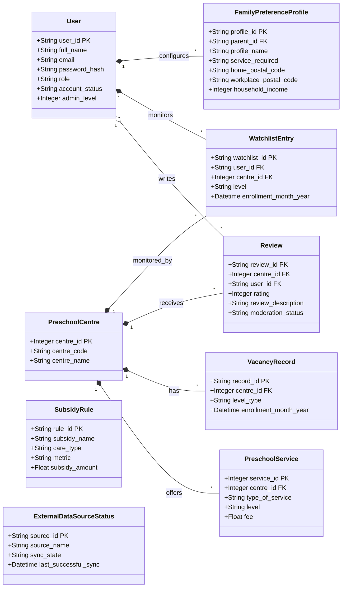

# Spec: User Identity, Family Preference Profiles, and Preschool Matching Entities

## Problem Statement

When parents and caregivers use KidCareMatch, they need a personalized experience to discover preschool centres, evaluate costs after government subsidies, monitor vacancy availability for their child's age group, and share feedback with the community. Currently, the platform's data layer only stores raw preschool centre profiles, vacancy horizons, and service offerings synchronized from data.gov.sg.

The platform lacks user account models, preventing parents from saving search preferences or bookmarking centres. Parents cannot monitor vacancies for specific child cohorts, nor can they submit centre reviews. Furthermore, system administrators have no database entities to configure Singapore early childhood subsidy rules, moderate community reviews, or track the operational health and sync status of external government datasets. Without these foundational database models, personalized matching, subsidy calculations, and community moderation cannot be developed.

## Solution

Expand the database schema in the persistence layer with seven cohesive relational entities:

1. **`User`**: A unified user identity table supporting both Parents and Administrators via a role discriminator, incorporating account status and optional administrative tiers (`admin_level`).
2. **`FamilyPreferenceProfile`**: A 1-to-many child and matching preference profile belonging to a Parent, capturing target enrollment horizons, dynamic preschool service requirements, postal locations (home and workplace), household income, budget caps, and multi-criteria weighting (cost vs. travel).
3. **`Review`**: A community feedback entity linking parents to preschool centres via surrogate primary keys (`centre_id`), capturing 1-to-5 star ratings, descriptive text, submission timestamps, and an explicit moderation workflow (`PENDING`, `APPROVED`, `REJECTED`) with single-review enforcement per centre.
4. **`WatchlistEntry`**: A cohort-specific vacancy alert subscription allowing parents to monitor availability for a specific age level (e.g. Infant, Playgroup, Nursery 1) and target enrollment month at a preschool centre.
5. **`SubsidyRule`**: A government funding rule table supporting Singapore ECDA/MSF early childhood subsidies across care types (Infant Care vs. Child Care), applicant tiers (e.g. Working Mother vs. Non-Working Mother), and means-test metrics (Household Income vs. Per Capita Income).
6. **`ExternalDataSourceStatus`**: An operational heartbeat record per data source tracking sync state (`IDLE`, `RUNNING`, `SUCCESS`, `FAILED`), last sync timestamps, record counts, and error diagnostic traces.
7. **Relational Integrity and Bidirectional Navigation**: Seamless relationship back-populates on `PreschoolCentre` and `User` maintaining strict database-level foreign key constraints.

## User Stories

1. As a parent, I want to register a user account with my email, password hash, and full name, so that I can access personalized childcare matching features.
2. As a parent, I want my email address to be unique across all registered accounts, so that my account credentials and identity remain distinct.
3. As a parent, I want my account status to reflect whether my account is active or suspended, so that system access restrictions are enforced reliably.
4. As an administrator, I want my administrative privileges and tier (`admin_level`) recorded on my user identity, so that administrative actions can be authorized by the system.
5. As a system architect, I want parents and administrators to reside in a unified `User` table with a `role` discriminator, so that credential management, authentication, and session handling remain clean and consolidated.
6. As a parent, I want to create a Family Preference Profile, so that the matching engine can evaluate preschool centres against my family's specific needs.
7. As a parent with multiple young children, I want to create multiple Family Preference Profiles under my account, so that I can configure separate matching preferences for each child's age group and enrollment timeline.
8. As a parent, I want to assign a profile name (such as my child's name or scenario) to each preference profile, so that I can easily differentiate between them.
9. As a parent, I want to specify a required service category (e.g. "Full Day", "Half Day") derived from the official preschool services dataset, so that my matching results filter for valid program offerings.
10. As a parent, I want to specify both my home postal code and my workplace postal code, so that commute proximity can be calculated from either daily anchor location.
11. As a parent, I want to select a location preference (Home, Workplace, or Either), so that centre distance scoring reflects my preferred commute routine.
12. As a parent, I want to record my gross monthly household income and child's Singapore citizenship status in my profile, so that applicable government early childhood subsidies can be automatically computed.
13. As a parent, I want to set a target enrollment month and year, so that matching algorithms evaluate vacancy openings for my intended admission period.
14. As a parent, I want to specify a maximum monthly budget, so that centres with net fees exceeding my budget are flagged or filtered out.
15. As a parent, I want to assign relative weights to cost and travel convenience (e.g. 70% cost, 30% travel), so that centre ranking aligns with my family's priorities.
16. As a parent, I want to submit a 1-to-5 star rating and written review for a Preschool Centre my child attended, so that other families can benefit from my experience.
17. As a system, I want each review to record the exact submission timestamp in UTC, so that reviews are displayed in chronological order.
18. As a parent, I want to be able to edit my existing review for a preschool centre, while being prevented from creating multiple duplicate reviews for the same centre.
19. As a system, I want to enforce a database-level unique constraint on `(centre_id, user_id)` for reviews, so that review ratings cannot be manipulated through repeated submissions.
20. As an administrator, I want newly submitted reviews to enter a `PENDING` moderation status, so that reviews can be vetted before appearing publicly.
21. As an administrator, I want to update a review's moderation status to `APPROVED` or `REJECTED`, recording my user ID and moderation timestamp, so that moderation actions are accountable and audited.
22. As a parent, I want to add a Preschool Centre to my watchlist for a specific age level (e.g. Infant Care or Nursery 1) and target enrollment month, so that I can track vacancy changes for my child's cohort.
23. As a parent, I want my watchlist subscription to be specific to my child's age level, so that I am not notified about irrelevant vacancies in other age groups.
24. As a system, I want to enforce a unique constraint on `(user_id, centre_id, level, enrollment_month_year)` in the watchlist table, so that duplicate subscriptions for the same cohort are prevented.
25. As a parent, I want to view all active watchlist subscriptions in my dashboard, so that I can monitor availability across multiple shortlisted centres.
26. As an administrator, I want to define Subsidy Rules specifying lower and upper income thresholds, metric types, and subsidy grant amounts, so that government means-tested subsidies are calculated accurately.
27. As an administrator, I want Subsidy Rules to distinguish between Basic Subsidy and Additional Subsidy tiers, so that both universal and income-tiered assistance are modeled correctly.
28. As an administrator, I want Subsidy Rules to specify applicant eligibility conditions (such as Working Mother vs. Non-Working Mother), so that Singapore ECDA subsidy policies are reflected faithfully.
29. As an administrator, I want Subsidy Rules to have an effective date timestamp, so that future policy changes and historical subsidy rules can be maintained over time.
30. As an administrator, I want to view the real-time operational status of external data synchronization jobs (such as ECDA datasets from data.gov.sg), so that I can monitor data freshness.
31. As an administrator, I want each data source record to show its sync state (`IDLE`, `RUNNING`, `SUCCESS`, `FAILED`), last successful sync timestamp, last attempted sync timestamp, and total records processed, so that pipeline health is visible.
32. As an automated synchronization job, I want to update the data source status record with error details when a sync fails, so that engineers can quickly inspect and resolve external API failures.
33. As a database developer, I want `Review` and `WatchlistEntry` entities to link to `PreschoolCentre` via the surrogate primary key `centre_id: int`, so that all child tables in the database maintain uniform foreign key integrity.

## Implementation Decisions

- **Single-Table Identity Architecture for User**: Rather than using joined-table inheritance or disconnected user models, `User` and `Administrator` are unified in a single table with an indexed `role` column (`PARENT`, `ADMIN`) and an optional `admin_level: Optional[int]`. This eliminates polymorphic query overhead in SQLModel while cleanly accommodating administrative staff and parents.
- **Relational Integrity via Surrogate Primary Key (`centre_id`)**: In accordance with existing relationships on `VacancyRecord` and `PreschoolService`, both `Review` and `WatchlistEntry` reference `PreschoolCentre.centre_id` (`int`) as their foreign key rather than `centre_code` (`str`). This preserves relational consistency, enables native foreign key cascade constraints, and simplifies SQLModel ORM relationship mappings.
- **Dynamic Categorical Service Requirements**: `FamilyPreferenceProfile.service_required` is stored as a categorical `str` corresponding to values from the `Type Of Service` column in the ECDA centre services dataset (e.g. "Full Day", "Half Day"). This decouples the family's search criteria from individual centre offerings.
- **1-to-Many Composition for Family Preference Profiles**: A parent user owns zero or more `FamilyPreferenceProfile` records (`Parent "1" *-- "*" FamilyPreferenceProfile`), allowing parents with multiple children or different search scenarios to persist independent matching criteria.
- **Strict Review Uniqueness and Tri-State Moderation**: `Review` enforces a composite unique constraint across `(centre_id, user_id)`. Moderation is governed by an explicit status string (`PENDING`, `APPROVED`, `REJECTED`) accompanied by `moderated_at` and `moderated_by` audit fields, rather than an ambiguous boolean flag. Ratings are validated between 1 and 5 inclusive.
- **Cohort-Specific Vacancy Watchlist**: `WatchlistEntry` includes a `level: str` column and enforces a composite unique constraint on `(user_id, centre_id, level, enrollment_month_year)`. This reflects the Singapore childcare domain where vacancy availability is strictly tracked per level (infant, pg, n1, n2, k1, k2).
- **Comprehensive Subsidy Rule Structure**: `SubsidyRule` models Singapore ECDA subsidies with `subsidy_name`, `tier_name`, `care_type` (`INFANT_CARE`, `CHILD_CARE`), `metric` (`HOUSEHOLD_INCOME`, `PER_CAPITA_INCOME`, `FIXED`), `applicant_status` (`WORKING_MOTHER`, `NON_WORKING_MOTHER`), `citizenship` (`SC`), income bounds, and grant amount.
- **Singleton Heartbeat Record for External Data Sources**: `ExternalDataSourceStatus` maintains a primary record per external provider (e.g. `ECDA_DATASTORE`) capturing live sync state (`IDLE`, `RUNNING`, `SUCCESS`, `FAILED`), execution timestamps, records processed, and diagnostic error traces.

## Testing Decisions

- **What makes a good test**: Tests must verify externally observable behavior and relational integrity rather than internal ORM mechanics. Specifically, tests must assert:
  - Table creation and schema initialization without syntax or metadata collision errors.
  - User creation, password hash persistence, email uniqueness rejection, and role assignment.
  - Multi-profile creation under a single parent user.
  - Review rating boundary enforcement (1 to 5) and single-review constraint violation upon duplicate submission.
  - Watchlist entry persistence, level-specific subscription tracking, and composite unique constraint enforcement.
  - Subsidy rule filtering across income thresholds and applicant criteria.
  - External data source heartbeat transition from `RUNNING` to `SUCCESS` or `FAILED`.
- **Modules tested**:
  - The persistence schema layer in `db.py`.
- **Seams**:
  - **Primary Seam (Persistence and Relational Integrity)**: The SQLModel session interface `Session(engine)` against an isolated in-memory SQLite database engine (`sqlite:///:memory:`). This single seam exercises the entire persistence surface (table generation, constraint validation, foreign key navigation, and query execution) without requiring network or external database dependencies.
- **Prior Art**: The existing test suite in `tests/test_sync_centres.py` leverages SQLModel sessions with SQLite engines to validate data transformations and database commits.

## Out of Scope

- User authentication HTTP endpoints (e.g. `/api/auth/register`, `/api/auth/login`, JWT issuing, and password hashing salts).
- Frontend UI components, rating stars widgets, or watchlist dashboard views.
- Outbound vacancy notification dispatchers (e.g. Email or SMS services).
- Algorithmic ranking calculation combining distance and fees (matching engine logic is handled by a separate service).
- Modification of external data schemas provided by ECDA or data.gov.sg.

## Further Notes

- All terminology adheres strictly to `GLOSSARY.md` (`Preschool Centre`, `Preschool Service`, `Vacancy Record`, `Relative Horizon Month`, `User`, `Administrator`, `Family Preference Profile`, `Review`, `Watchlist Entry`, `Subsidy Rule`, `External Data Source Status`).
- Architectural decisions are formally recorded in `docs/adr/0002-user-and-matching-entities.md`.
- Once `gh` credentials are authenticated, this specification can be published directly to GitHub issues with the `ready-for-agent` triage label.
